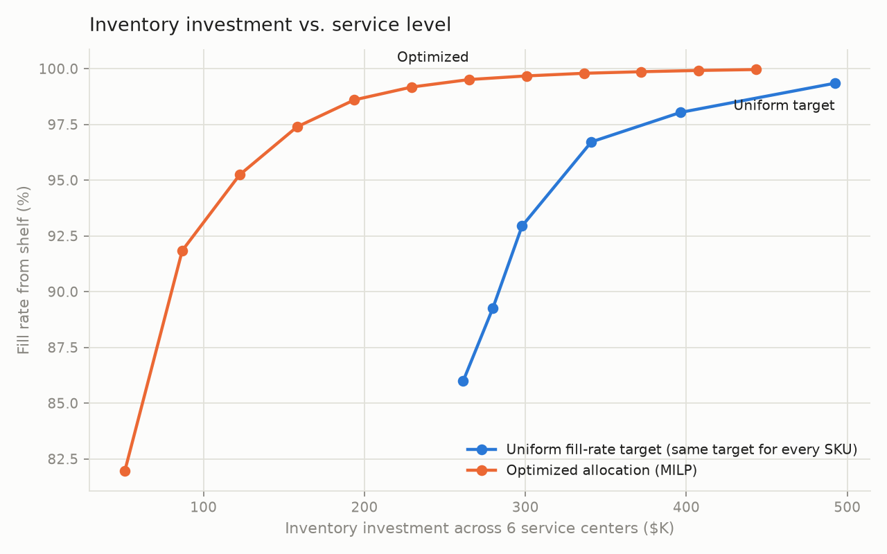
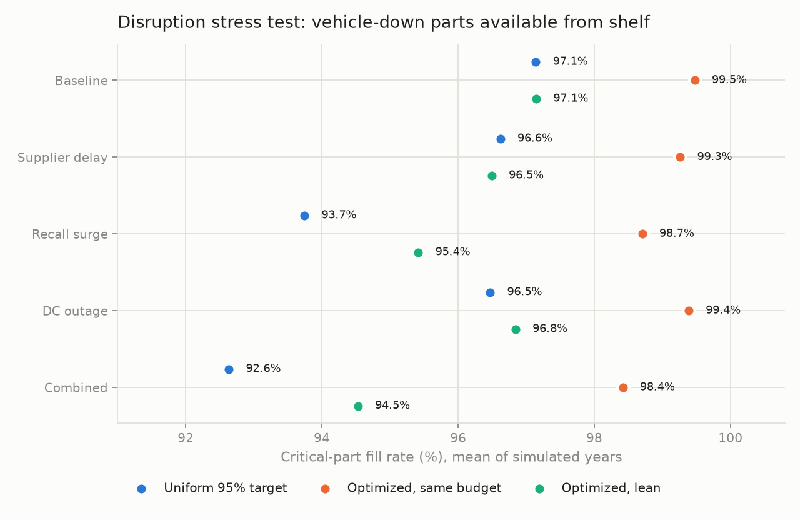

# EV Service Parts Inventory Optimization

How should an EV maker split a limited inventory budget across service centers, and how well does that plan hold up when the supply chain breaks?

This project models a service-parts network with **1 central distribution center (DC) and 6 regional service centers** stocking **40 SKUs**, from wiper blades to drive units. That makes **240 stocking decisions**. It then:

1. **Segments** parts by spend and demand variability (ABC-XYZ)
2. **Optimizes** base-stock levels with a **mixed-integer program (PuLP + CBC)** under an inventory budget, weighting vehicle-down-critical parts 3x
3. **Traces the efficient frontier** of inventory investment vs. service level
4. **Stress-tests** each policy with a **Monte Carlo simulation** (500 simulated years × 5 disruption scenarios)

> All data is synthetic, generated in `src/spares_opt/data.py` at plausible scale. No company data is used.

## Key results

| Policy | Inventory investment | Fill rate | Critical-part fill rate | Critical shortages / year |
| --- | ---: | ---: | ---: | ---: |
| Uniform 95% target (every SKU, every center) | $341K | 96.7% | 97.1% | 49.5 |
| **Optimized, same budget** | $341K | **99.8%** | **99.5%** | **9.0** |
| **Optimized, lean** (matches baseline service) | **$184K** | 98.4% | 97.1% | 49.4 |

- **Same money, better service.** Reallocating the same $341K raises the fill rate from 96.7% to 99.8% and cuts critical-part shortages by 82%.
- **Same service, less money.** The cheapest allocation that matches the baseline on *both* overall and critical fill rate needs **46% less inventory** ($341K to $184K), saving about **$39K a year** in holding cost.
- **Where the money moves.** A uniform target over-stocks expensive, slow-moving parts: it puts $56K into drive units alone. The optimizer moves that money into cheap, fast-moving and critical parts (wear items, suspension, 12V batteries). The lean plan stocks no drive units or HV battery modules at service centers at all, so those parts would ship from the DC instead.



### Disruption stress test

Critical-part fill rate, averaged over 500 simulated years per scenario:

| Scenario | Uniform 95% | Optimized, same budget | Optimized, lean |
| --- | ---: | ---: | ---: |
| Baseline | 97.1% | 99.5% | 97.1% |
| Supplier delay: HV/thermal/powertrain +3 weeks for 12 weeks | 96.6% | 99.3% | 96.5% |
| Recall surge: front control arm demand ×3 for 8 weeks | 93.7% | 98.7% | 95.4% |
| DC outage: no replenishment for 2 weeks | 96.5% | 99.4% | 96.8% |
| Combined | 92.6% | 98.4% | 94.5% |



**The tradeoff the fill rate hides.** The lean plan matches the baseline's critical fill rate, yet on average it has **1.5× as many critical parts on backorder** at any time (1.50 vs. 1.02), and **1.7× as many** during a supplier delay (2.41 vs. 1.42). The reason: it removes local stock of rare, expensive parts. Those parts are seldom requested, so the fill rate barely moves, but each miss leaves a vehicle waiting a full replenishment cycle. So the recommendation depends on what leadership values:

- If capital is the constraint, run the lean plan for routine parts and keep a small buffer of long-lead HV parts at the DC.
- If vehicle-down time is the constraint, the same-budget plan gives the most resilience per dollar.

## Method

### Inventory policy (`policy.py`)

Each center reviews weekly and orders up to a base-stock level *S*. Replenishment from the DC takes 1 week, so shelf stock must cover demand over the 2-week protection period. Weekly demand per SKU per center is Poisson.

- Expected backorders, closed form: `E[(D − S)+] = μ·P(D ≥ S) − S·P(D ≥ S+1)`
- Units short per week: `EBO(S; μ_L+R) − EBO(S; μ_L)`
- Fill rate (share of demand served from shelf) = `1 − units short / weekly demand`

The closed-form formulas are checked against brute-force summation in the tests, and the simulator reproduces the analytic fill rate within 0.1 percentage point.

### Optimization model (`optimize.py`)

- **Decision:** binary `z[i,k] = 1` if item *i* (SKU × center) is stocked at level *k*
- **Objective:** minimize Σ weight × expected units short per week (critical parts weight 3)
- **Constraints:** one level per item; Σ unit cost × stock ≤ budget; optional minimum fill rate for critical items
- About 2,000 binary variables; CBC solves each instance in under a second

Because expected shortage is convex in stock, the optimizer spends each extra dollar where it removes the most weighted shortage. Sweeping the budget traces the efficient frontier. A bisection on budget finds the cheapest plan that matches a reference policy's overall **and** critical fill rate, so savings never come from starving critical parts.

### Simulation (`simulate.py`)

Vectorized weekly simulation over 500 runs. Replenishment arrives and clears backorders first, then demand is filled from shelf or backordered, then the center reorders what it used. Scenarios modify demand or lead time for chosen parts and weeks. All policies see the same random demand streams (common random numbers), so differences between policies come from the policies themselves, not from noise.

## Run it

```bash
pip install -r requirements.txt
python run.py            # full analysis, about 30 seconds
python run.py --quick    # fewer runs, used in CI
pytest                   # 23 tests
```

Outputs go to `results/`: segmentation, allocations, frontier, stress test, investment by category, `summary.json`, and both charts.

## Limitations and next steps

- Single echelon: the DC is assumed to have stock except in the disruption scenarios. A multi-echelon model (e.g. METRIC) would optimize DC and center stock jointly.
- No lateral transshipment between nearby centers, which would further reduce the cost of stocking rare parts at only a few locations.
- Poisson demand with stationary rates; real service demand has seasonality, fleet-age effects and campaign-driven spikes.
- Investment is measured at base-stock level; average on-hand inventory is lower.

## Project structure

```
src/spares_opt/
  data.py        synthetic network: parts, centers, demand rates
  policy.py      base-stock math, fill rate, ABC-XYZ segmentation
  optimize.py    budget-constrained MILP, frontier, baseline policies
  simulate.py    Monte Carlo disruption simulation
run.py           end-to-end analysis and charts
tests/           unit tests for the math, optimizer and simulator
```
